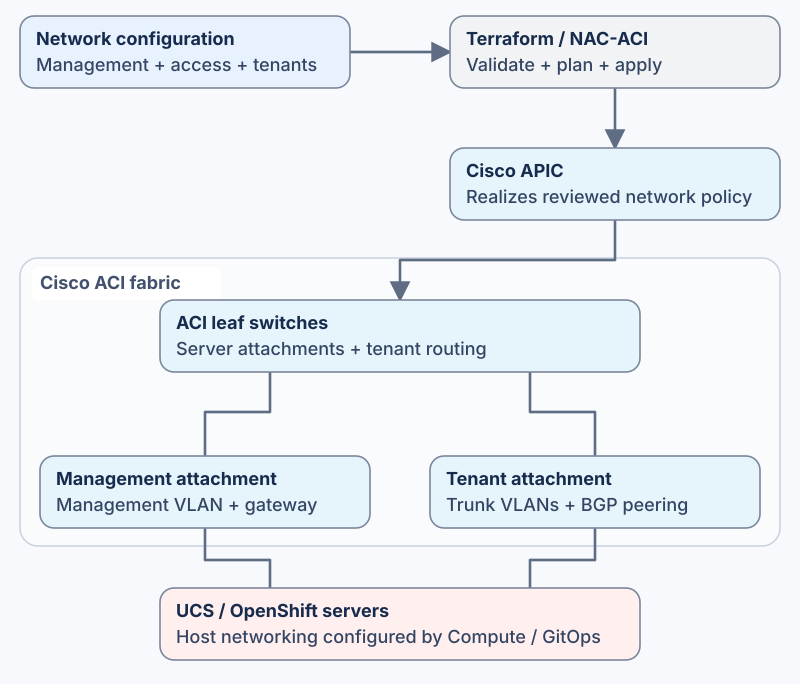

# Cisco Secure AI Fabric

Configure **Cisco ACI for the UCS and OpenShift platform**. This repository turns network configuration files into ACI policy through Terraform and Cisco APIC.

It provides management connectivity for the servers and tenant connectivity for Kubernetes services and VM workers. It is the network deployment component of [Cisco Secure AI Datacenter](https://github.com/mahowlin/secure-ai-datacenter).

## How it works

1. **Prepare the network configuration.** Import the files generated by Datacenter, or supply your own NAC-ACI YAML. These describe the networks, routing and server attachments you want.
2. **Review the Terraform plan.** The wrapper reads the selected configuration and compares it with ACI. Review which objects it will create, change or remove.
3. **Apply through your pipeline.** The configured site pipeline applies the reviewed plan through APIC. Check the resulting network state before using it for the cluster.

Datacenter generates matching host-network configuration for Compute and GitOps. Keep those changes together when changing VLANs, addresses or BGP settings.

## What is configured

| Area | Purpose | Files |
|---|---|---|
| Management network | Server management VLAN, gateway and endpoint group | [Management tenant](data/platform-management/) |
| Server connections | Switch ports, interface policies, VLAN pools and physical domains | [Management/access configuration](data/access/) |
| Tenant networks | Tenant VRF, service and VM-worker networks, BGP peers and routing policy | [Tenant configuration](data/tenant-workloads/) |

The [configuration guide](docs/CONFIGURATION.md) maps each file to its ACI objects and explains how the pieces fit together.

## Use this repository

**With Datacenter:** copy the generated `secure-ai-fabric/data/` contents into a dedicated deployment project. Preserve the matching `modules/`, `defaults/` and Terraform wrapper. The [fabric handoff](https://github.com/mahowlin/secure-ai-datacenter/blob/main/docs/architectures/FABRIC_NETWORK.md) gives the exact import and validation steps.

**With an existing NAC-ACI project:** import the reviewed YAML into your normal project and resolve overlapping object ownership. You can also start from the [minimal tenant example](examples/minimal/tenant.yml).

The wrapper reads **every YAML file matching `data/**/*.yml`**. Keep unrelated examples and old generated files outside that deployment directory.

## Prepare deployment

Use the [operating procedure](agents/operations.md) for setup, validation and pipeline execution. You will need:

- Terraform and the pinned NAC-ACI module/provider versions.
- An APIC address, private credentials and trusted CA material.
- Private remote state configuration.
- A commissioned ACI fabric and the required upstream connectivity.

The [Terraform directory](tf/) contains the wrapper, connection-input example and backend configuration. [Modules](modules/) and [defaults](defaults/) hold the execution policy inputs. The wrapper manages tenant and access policies; fabric-wide commissioning remains outside its scope. TLS verification stays enabled, and credentials and state stay out of Git.

## License and dependencies

See [LICENSE](LICENSE). The external [NAC-ACI module](https://github.com/netascode/terraform-aci-nac-aci) uses Apache-2.0. Provider binaries and installed module caches are not redistributed.
